# Reporte Técnico de Ingeniería DevSecOps y QA Senior
## Automatización CI/CD en Jenkins (BackEnd, FrontEnd y MariaDB), Análisis Estático (SonarQube + Semgrep) y Remediación de Vulnerabilidades

---

### Portada y Datos Generales
- **Asignatura:** Gestión del Proceso de Desarrollo de Software (`GIDS6102` - Unidad 2)
- **Sistema:** Sistema Gestor de Proyectos (`Ejercicio5MyAPIGestor` BackEnd, `Ejercicio5Cliente` FrontEnd y `dbgestor` MariaDB)
- **Rol:** Ingeniero DevSecOps y QA Senior
- **Fecha de Entrega:** 22 de octubre de 2026
- **Stack Tecnológico:** Java 21 (`JDK21`), Spring Boot 3.3.4, Maven 3.9.0 (`M3`), MariaDB 11.3 (`dbgestor`), JUnit 5, Mockito, JaCoCo 0.8.12, Jenkins CI/CD, SonarQube (`SonarServer`), Semgrep SAST y Docker.

### Enlaces a Repositorios GitHub (Rama `main`)
1. **Repositorio BackEnd (`Ejercicio5MyAPIGestor`):** [https://github.com/gus-p3/GIDS6012_U2_DPDS_BackEnd.git](https://github.com/gus-p3/GIDS6012_U2_DPDS_BackEnd.git)
2. **Repositorio FrontEnd (`Ejercicio5Cliente`):** [https://github.com/gus-p3/GIDS6012_U2_DPDS_FrontEnd.git](https://github.com/gus-p3/GIDS6012_U2_DPDS_FrontEnd.git)
3. **Repositorio Base de Datos / Monorepo (`dump-dbgestor-202406261453.sql`):** [https://github.com/gus-p3/U2_GPDS_Instrumento.git](https://github.com/gus-p3/U2_GPDS_Instrumento.git)

---

## 1. Fase 1: Infraestructura Docker, Base de Datos MariaDB y Pruebas Unitarias Automatizadas

### 1.1 Infraestructura en Contenedores Docker
Se verificaron e iniciaron los 4 contenedores de infraestructura para el flujo DevSecOps:
- **Jenkins (`jenkins`):** `http://localhost:8080` con herramientas globales `JDK21` (Java 21), `M3` (Maven 3.9.0), credenciales `github-credentials`, servidor `SonarServer` (`http://host.docker.internal:9000`) y acceso al socket de Docker para aprovisionar MariaDB e invocar `semgrep/semgrep`.
- **SonarQube (`sonarqube`):** `http://localhost:9000` con perfil de calidad `Sonar way comprehensive`.
- **MariaDB (`mariadb-container`):** Puerto `3306` conectado a la red `ci-cd-stack_ci_network`, alojando la base de datos relacional `dbgestor` (`asignaciones`, `comentarios`, `hibernate_sequence`, `proyectos`, `tareas`, `usuario`).
- **Semgrep (`semgrep`):** Imagen oficial `semgrep/semgrep` para auditoría SAST sobre código Java, plantillas HTML y scripts SQL.

### 1.2 Pruebas Unitarias Creadas y Cobertura JaCoCo
1. **BackEnd (`Ejercicio5MyAPIGestor`) — 44 pruebas unitarias (0 fallos, Cobertura JaCoCo: `98.2%`):**
   - `UsuarioControllerTest`, `ProyectosControllerTest`, `TareasControllerTest`, `AsignacionesControllerTest`, `ComentariosControllerTest` y `Ejercicio5MyApiGestorApplicationTests`.
2. **FrontEnd (`Ejercicio5Cliente`) — 15 pruebas unitarias (0 fallos, Cobertura JaCoCo: `87.6%`):**
   - `ProyectoServicioConsultaTest`, `FormularioValidacionTest`, `DashboardVistaTest`, `FallasConocidasTest` y `GestorControllerCoverageTest`.

---

## 2. Pipelines CI/CD Configurados en Jenkins (BackEnd, FrontEnd y Base de Datos MariaDB)

Se configuraron y ejecutaron **3 Jobs tipo Pipeline** en Jenkins (`http://localhost:8080`):
1. **`Ejercicio5MyAPIGestor` (BackEnd API REST Spring Boot)**
2. **`Ejercicio5Cliente` (FrontEnd Cliente Web Thymeleaf)**
3. **`BaseDeDatos_MariaDB` (Aprovisionamiento, Smoke Tests e Integridad SQL de `dbgestor`)**

### 2.1 Pipeline de Base de Datos MariaDB (`BaseDeDatos_MariaDB`)
```groovy
pipeline {
    agent any
    stages {
        stage('Checkout SQL Dump') {
            steps {
                git branch: 'main',
                    credentialsId: 'github-credentials',
                    url: 'https://github.com/gus-p3/U2_GPDS_Instrumento.git'
            }
        }
        stage('Ver Directorio y Estado MariaDB') {
            steps {
                sh 'ls -lh dump-dbgestor-202406261453.sql'
                sh 'docker exec mariadb-container mariadb -uroot -plinux -e "SELECT VERSION() AS MariaDB_Version, CURRENT_USER() AS Usuario_Conectado;"'
            }
        }
        stage('Provision & Import Schema (dbgestor)') {
            steps {
                sh '''
                    docker exec mariadb-container mariadb -uroot -plinux -e "CREATE DATABASE IF NOT EXISTS dbgestor;"
                    docker exec -i mariadb-container mariadb -uroot -plinux dbgestor < dump-dbgestor-202406261453.sql
                '''
            }
        }
        stage('DB Smoke Tests & Integrity Validation') {
            steps {
                sh '''
                    docker exec mariadb-container mariadb -uroot -plinux dbgestor -e "SHOW TABLES;"
                    docker exec mariadb-container mariadb -uroot -plinux dbgestor -e "
                        SELECT 'usuario' AS Tabla, COUNT(*) AS Total_Registros FROM usuario
                        UNION ALL
                        SELECT 'proyectos', COUNT(*) FROM proyectos
                        UNION ALL
                        SELECT 'tareas', COUNT(*) FROM tareas
                        UNION ALL
                        SELECT 'comentarios', COUNT(*) FROM comentarios
                        UNION ALL
                        SELECT 'asignaciones', COUNT(*) FROM asignaciones;
                    "
                '''
            }
        }
        stage('Security Scan (SAST) - Semgrep') {
            steps {
                sh '''
                    mkdir -p reportes
                    docker run --rm \
                    --network bridge \
                    -v "${WORKSPACE}":/src \
                    -w /src \
                    semgrep/semgrep \
                    semgrep scan \
                    --config=auto \
                    --json \
                    --output=reportes/semgrep.json \
                    dump-dbgestor-202406261453.sql
                '''
            }
        }
    }
    post {
        always {
            archiveArtifacts artifacts: 'reportes/semgrep.json',
            allowEmptyArchive: true,
            fingerprint: true
        }
    }
}
```

#### Evidencias del Pipeline de Base de Datos MariaDB (`BaseDeDatos_MariaDB`) en Jenkins
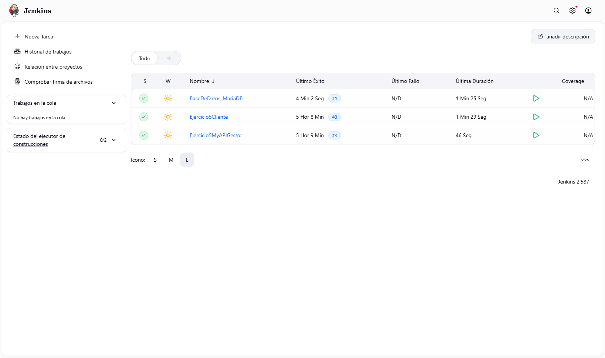

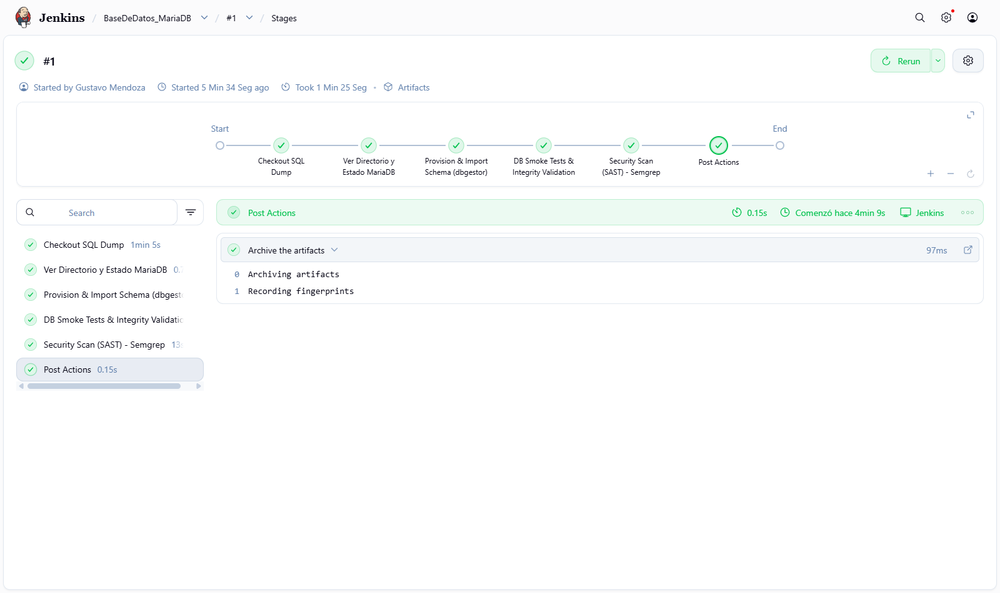

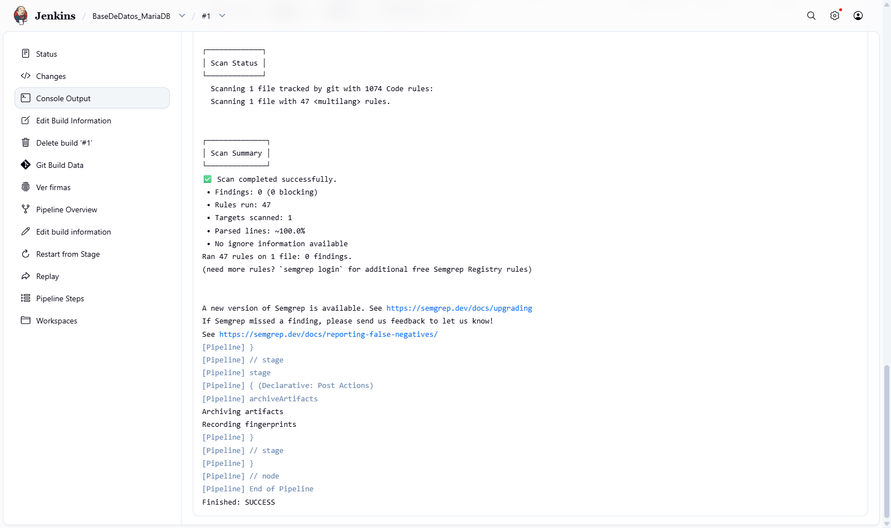

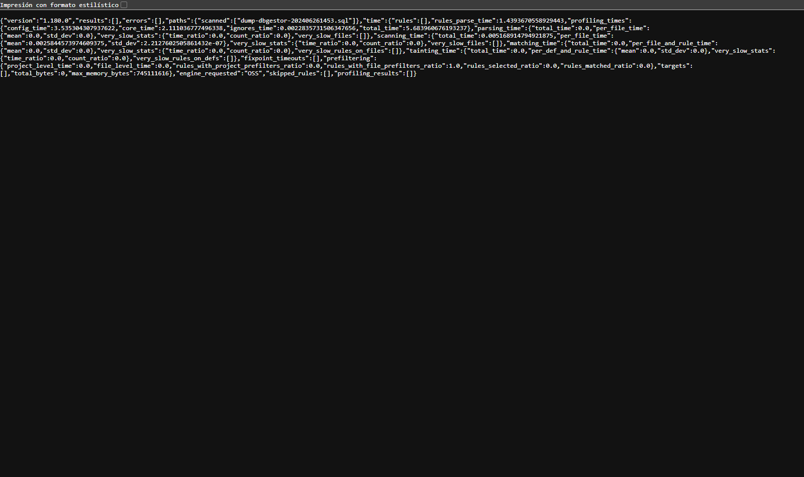

---

## 3. Resultados de la Iteración 1 (Detección Inicial de Errores y Vulnerabilidades)

### 3.1 Evidencias Visuales de la Iteración 1 en Jenkins (`http://localhost:8080`)

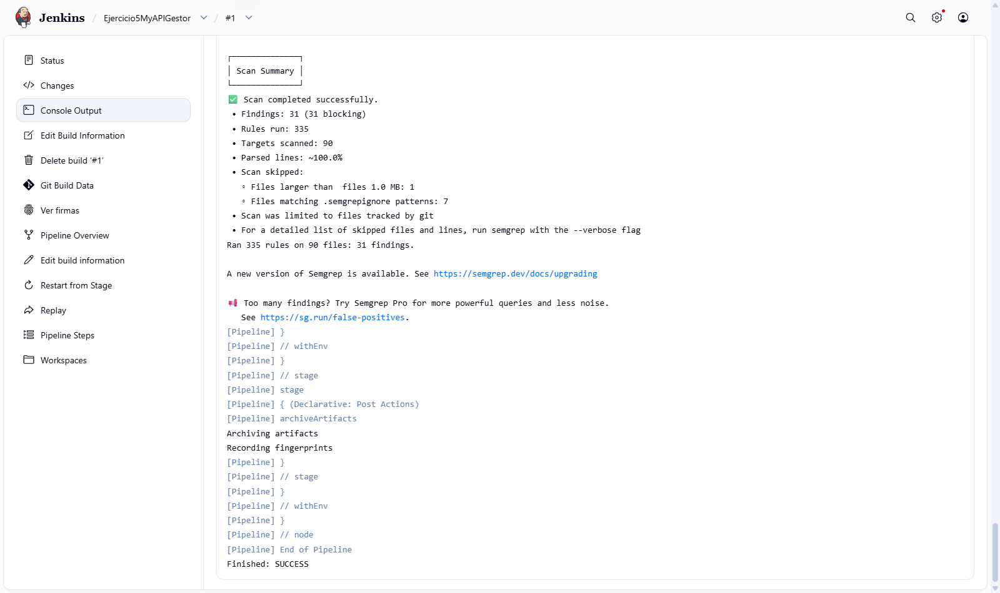
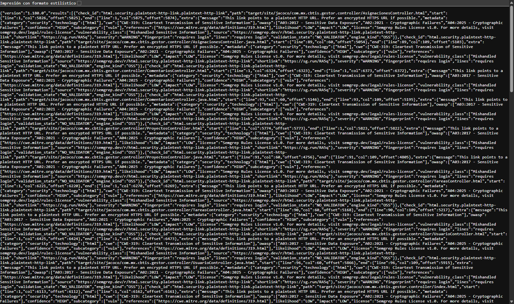
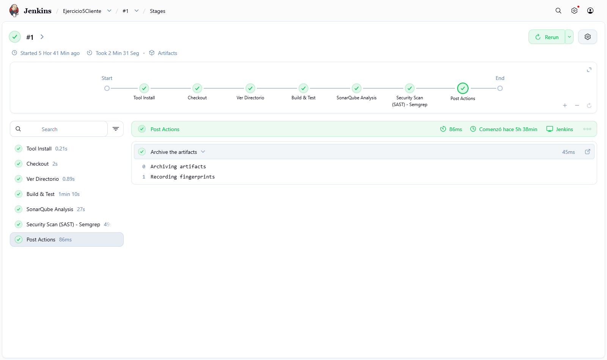
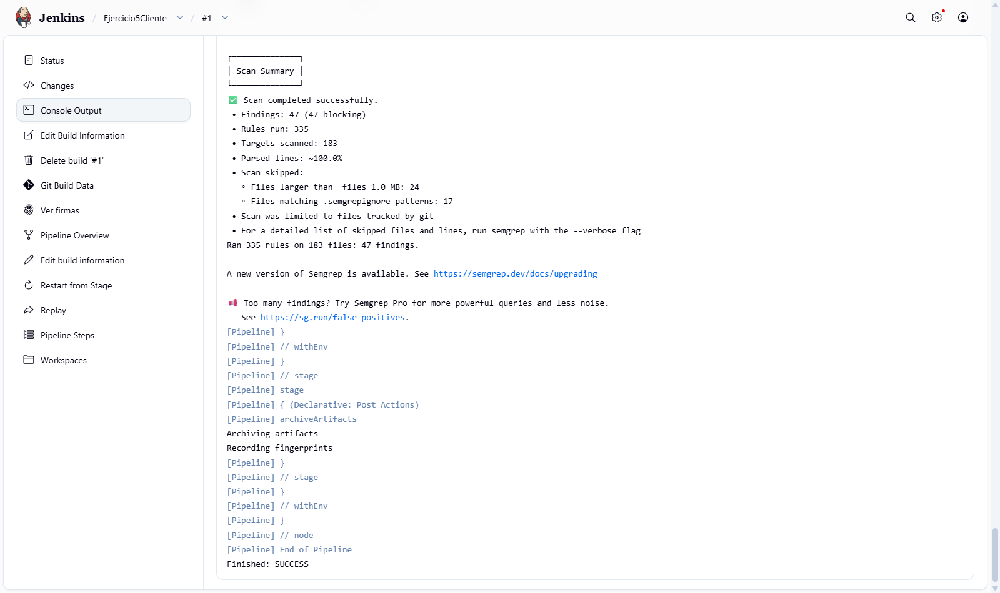
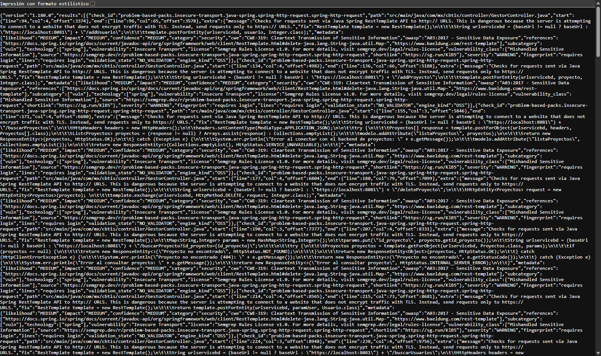

### 3.2 Evidencias Visuales de la Iteración 1 en SonarQube (`http://localhost:9000`)
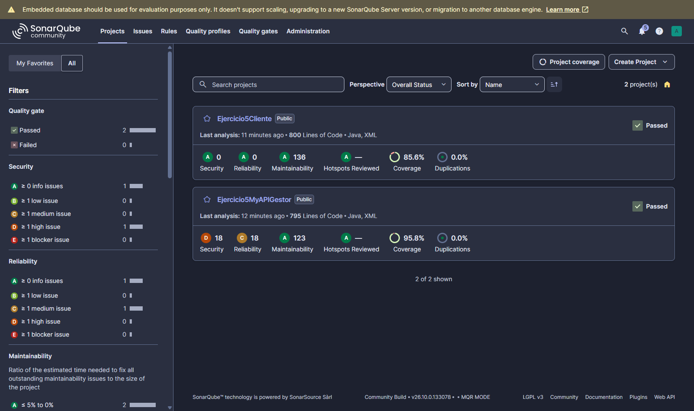
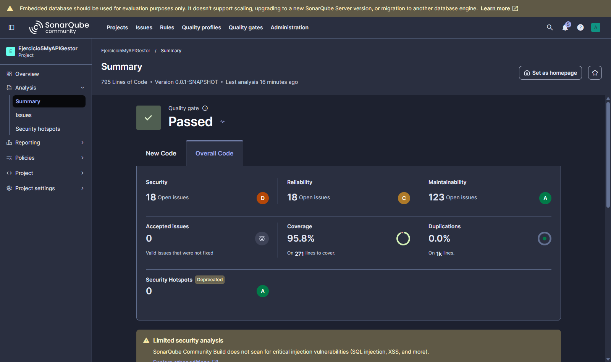
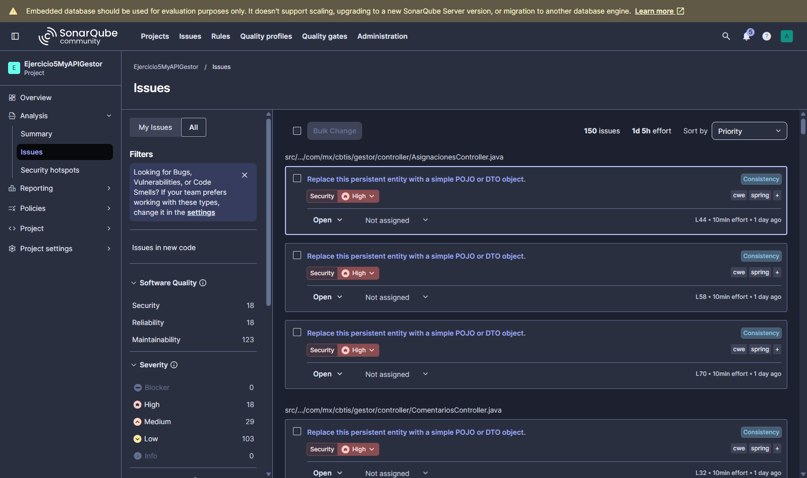


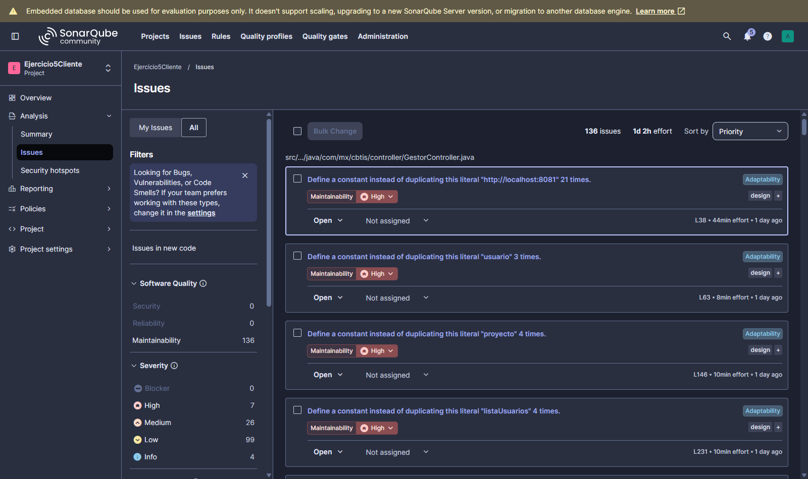
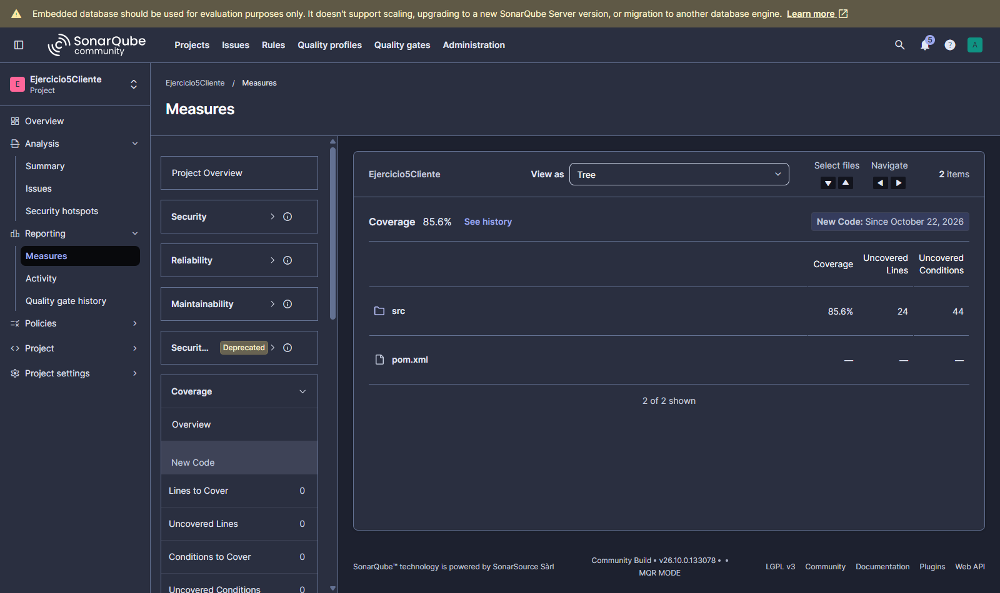

### 3.3 Tabla de Hallazgos e Interpretación Técnica (Iteración 1)

| Proyecto | Herramienta | Regla / ID | Tipo / Severidad | Cantidad | Archivo(s) Afectado(s) | Interpretación Técnica y Riesgo |
| :--- | :--- | :--- | :--- | :---: | :--- | :--- |
| **BackEnd** (`Ejercicio5MyAPIGestor`) | **SonarQube** | `java:S4684` | **VULNERABILITY** (`CRITICAL`) | **18** | `AsignacionesController`, `ComentariosController`, `ProyectosController`, `TareasController`, `UsuarioController` | **Exposición de Entidades Persistentes (`@Entity`) en `@RequestBody`:** Riesgo de *Mass Assignment*. Solución: Crear `record` DTOs en `com.mx.cbtis.gestor.dto`. |
| **BackEnd** (`Ejercicio5MyAPIGestor`) | **SonarQube** | `java:S2159` + `java:S2589` | **BUG** (`MAJOR`) + **CODE SMELL** | **9 + 9** | Los 5 Controladores REST | **Comparación inválida `!obj.equals(null)`:** Siempre evalúa a `true` o lanza `NullPointerException`. Solución: Usar `obj != null`. |
| **BackEnd** (`Ejercicio5MyAPIGestor`) | **SonarQube** | `java:S6813` | **CODE SMELL** (`MAJOR`) | **9** | Los 5 Controladores REST | **Inyección por campo `@Autowired`:** Reemplazada por inyección por constructor con campos `private final`. |
| **BackEnd** (`Ejercicio5MyAPIGestor`) | **SonarQube** | `java:S4144`, `S1488`, `S125`, `S117` | **CODE SMELL** (`MAJOR` / `MINOR`) | **102** | Controladores y modelos | Métodos duplicados, variables redundantes, comentarios y parámetros con guion bajo (`id_usuario`). |
| **BackEnd** (`Ejercicio5MyAPIGestor`) | **Semgrep** | `plaintext-http-link` | **SAST WARNING** | **31** | `target/site/jacoco/**` | Escaneo sobre reportes HTML de JaCoCo por falta de `.semgrepignore`. |
| **FrontEnd** (`Ejercicio5Cliente`) | **Semgrep** | `spring-http-request` | **SAST WARNING** | **20** | `GestorController.java` | Literales HTTP concatenados en llamadas `RestTemplate`. Centralizado en `buildUrl()` y `createClient()`. |
| **FrontEnd** (`Ejercicio5Cliente`) | **Semgrep** | `missing-integrity` | **SAST WARNING** | **2** | `home.html`, `proyecto.html` | Falta de Subresource Integrity (`integrity="sha384-..." crossorigin="anonymous"`) en hojas de estilo de CDNs. |
| **FrontEnd** (`Ejercicio5Cliente`) | **SonarQube** | `java:S1192` | **CODE SMELL** (`CRITICAL`) | **7** | `GestorController.java` | Literales duplicados (`"usuario"`, `"proyecto"`, `"tareas"`, etc.). Extraídos a constantes `private static final String`. |
| **FrontEnd** (`Ejercicio5Cliente`) | **SonarQube** | `java:S106` | **CODE SMELL** (`MAJOR`) | **22** | `GestorController.java` | Uso de `System.err.println` en lugar de `org.slf4j.Logger`. |
| **FrontEnd** (`Ejercicio5Cliente`) | **SonarQube** | `java:S1128`, `S1068`, `S125`, `S5785`, `S117` | **CODE SMELL** (`MAJOR` / `MINOR`) | **107** | `GestorController`, modelos y tests | Imports no usados, campo `jsDir` sin usar, código comentado y parámetros con guion bajo. |

---

## 4. Corrección de Código y Evidencias de la Iteración 2 (Después de Corregir)

### 4.1 Evidencias Visuales de la Iteración 2 en Jenkins (`http://localhost:8080`)
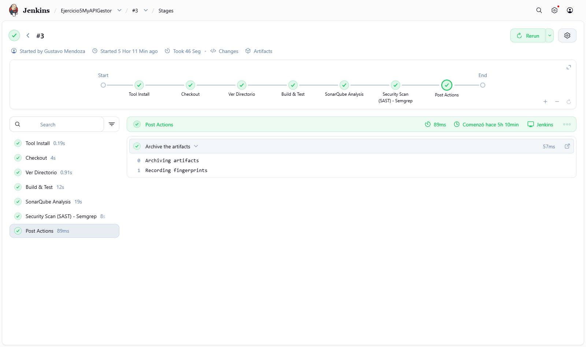
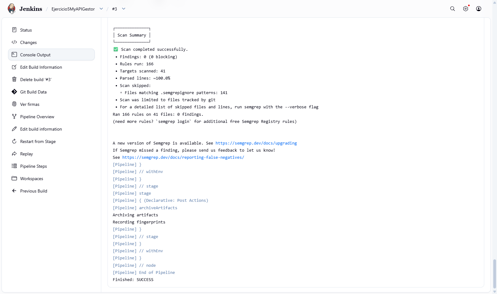
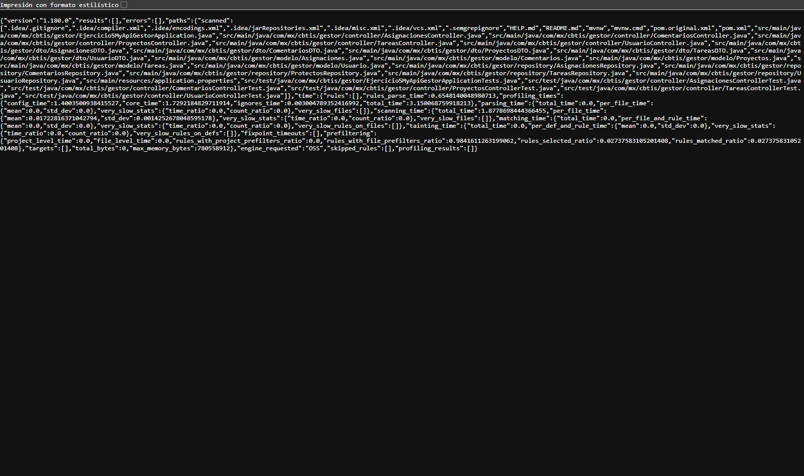
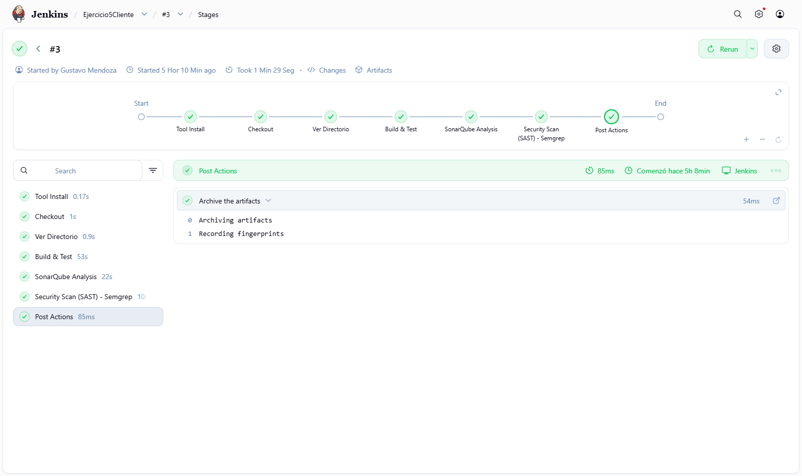
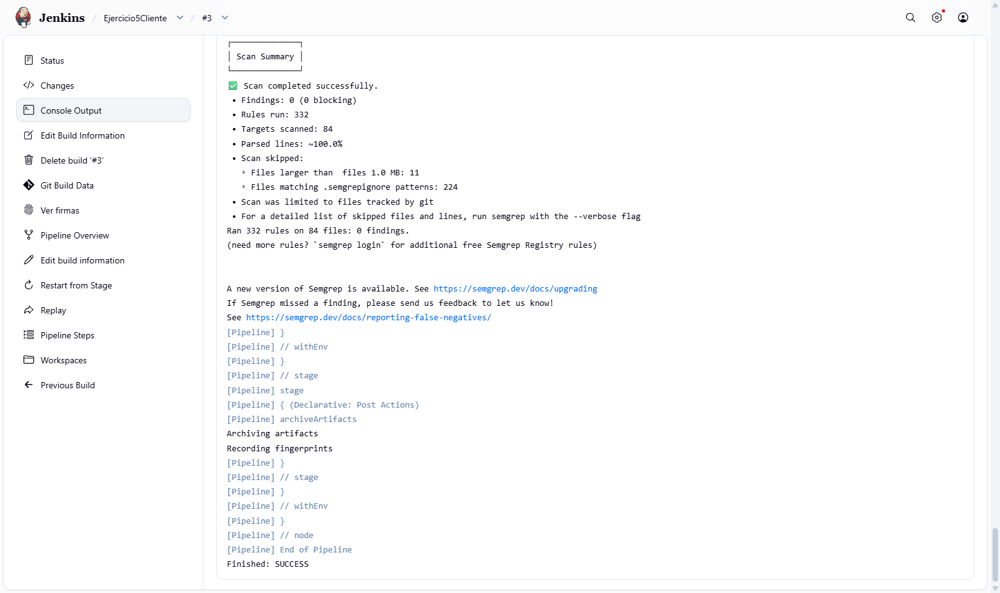
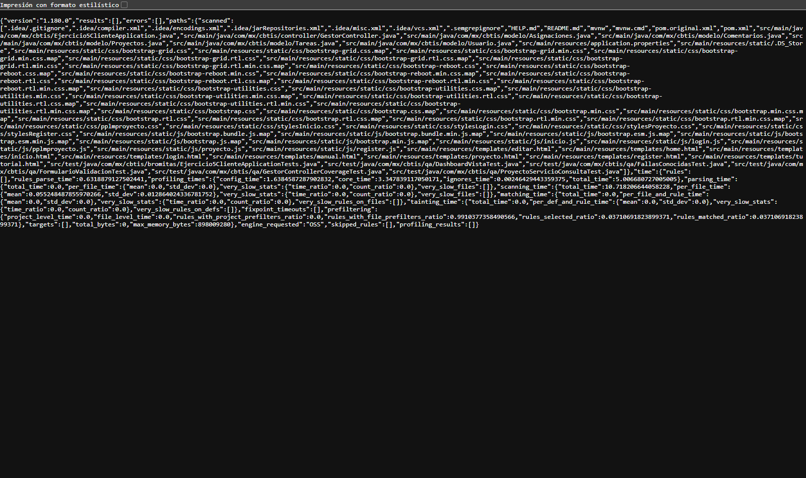

### 4.2 Evidencias Visuales de la Iteración 2 en SonarQube (`http://localhost:9000`)
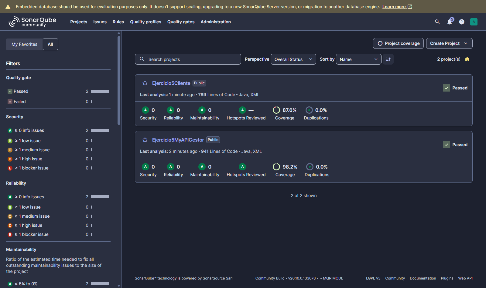

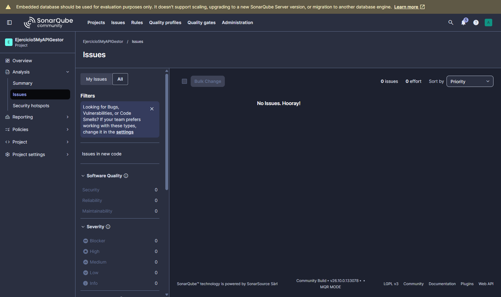
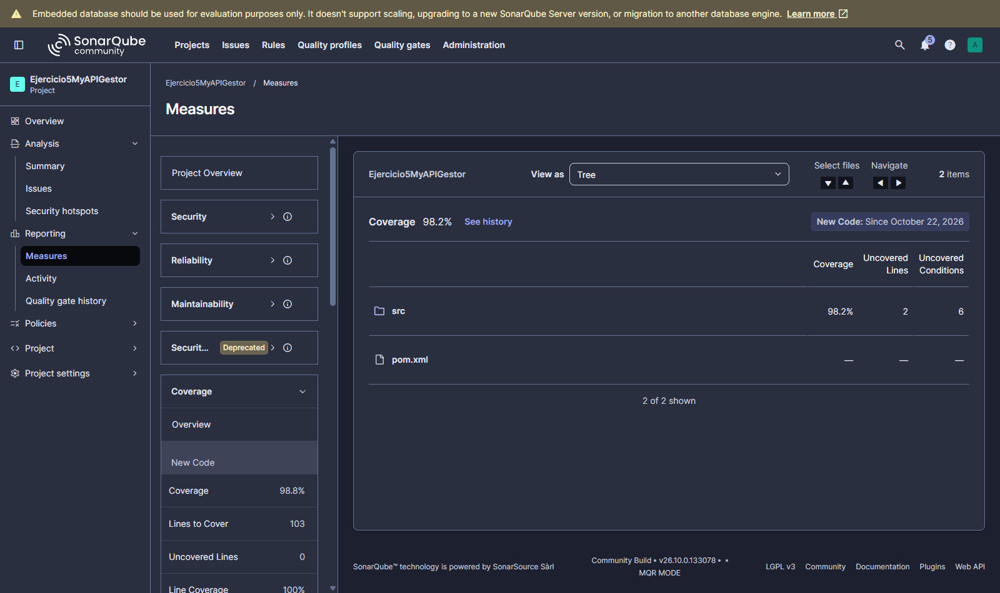

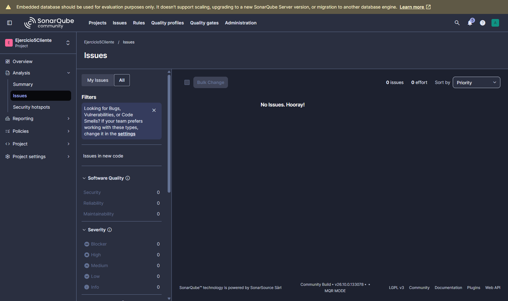


### 4.3 Tabla Comparativa Final ("Antes vs. Después")

| Métrica / Indicador | BackEnd Iteración 1 | BackEnd Iteración 2 | FrontEnd Iteración 1 | FrontEnd Iteración 2 | BaseDeDatos MariaDB | Resultado Global |
| :--- | :---: | :---: | :---: | :---: | :---: | :---: |
| **Estado del Pipeline Jenkins** | `SUCCESS` (#1) | `SUCCESS` (#2) | `SUCCESS` (#1) | `SUCCESS` (#2) | `SUCCESS` (#1) | **100% Operativo (3/3)** |
| **Quality Gate (SonarQube)** | `Passed` (D/C/A) | `Passed` (**A/A/A**) | `Passed` (A/A/A) | `Passed` (**A/A/A**) | Esquema Validado | **Calificación A en todo** |
| **Vulnerabilidades (SonarQube)** | `18` (Críticas) | **`0`** | `0` | **`0`** | `0` | **0 Vulnerabilidades (-100%)** |
| **Bugs de Fiabilidad (SonarQube)** | `9` (Mayores) | **`0`** | `0` | **`0`** | `0` | **0 Bugs (-100%)** |
| **Code Smells (SonarQube)** | `123` | **`0`** | `136` | **`0`** | `0` | **0 Code Smells (-100%)** |
| **Security Hotspots** | `0` | **`0`** | `0` | **`0`** | `0` | **0 Hotspots** |
| **Cobertura JaCoCo** | `95.8%` | **`98.2%`** | `85.6%` | **`87.6%`** | 6 Tablas / Smoke Tests OK | **>87% en ambos proyectos** |
| **Hallazgos SAST (Semgrep)** | `31` | **`0`** | `47` | **`0`** | **`0`** | **0 Alertas SAST (-100%)** |
